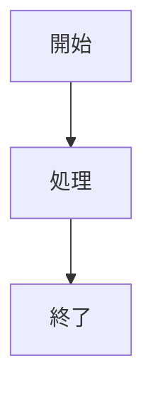

# {{TITLE}}

対象要件: [spec-requirements.md](../../specs/{{spec-folder}}/spec-requirements.md) / [tech-requirements.md](../../specs/{{spec-folder}}/tech-requirements.md)

## 目次

- [概要](#概要)
- [技術選定・アーキテクチャ](#技術選定アーキテクチャ)
- [フォルダ構成](#フォルダ構成)
- [処理の流れ](#処理の流れ)
- [動作確認（正常系）](#動作確認正常系)

## 概要

<!-- 実装する機能の概要と対象範囲 -->

## 技術選定・アーキテクチャ

<!-- 候補、評価軸、採否と根拠。責務境界、外部システム、REQ-IDごとの実現方針も記載する。 -->

| 領域 | 候補 | 選定 | 根拠 | 対象要件 |
| --- | --- | --- | --- | --- |
| {{領域}} | {{候補}} | {{選定}} | {{根拠}} | REQ-001 |

## フォルダ構成

<!-- 新規作成するファイルには [NEW]、既存ファイルの改修には [MOD] を付ける。 -->

```
src/
  feature/
    example.ts  # {{説明}} [NEW]
```

## 処理の流れ



## 動作確認（正常系）

<!-- テストコードは書かない。画面操作または API から正常系を確認する。 -->

| 対象要件 | 前提条件 | 画面操作 | 期待結果 |
| --- | --- | --- | --- |
| REQ-001 | {{前提}} | {{操作}} | {{期待結果}} |
