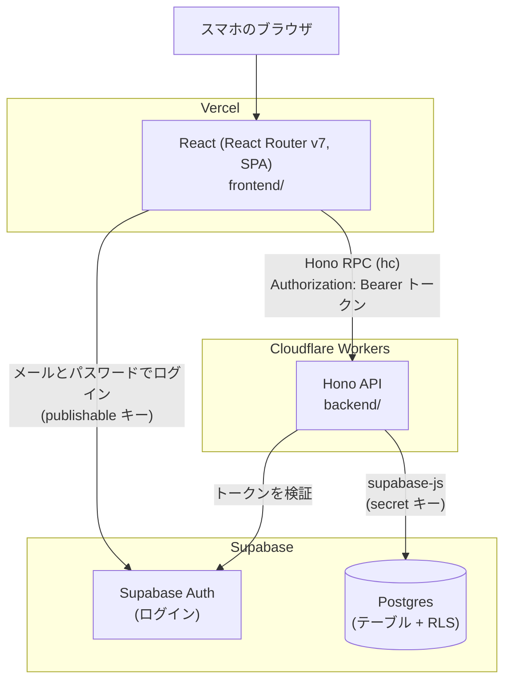
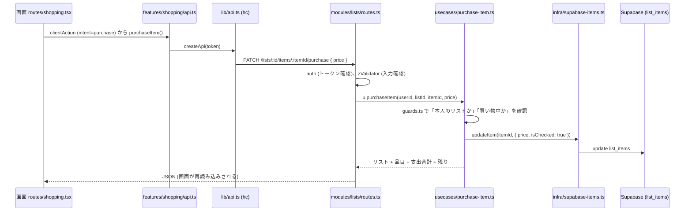

# アーキテクチャ (全体のつながり)

このページは「どこに何があるか」をつかむための地図です。
層のルールや禁止 import などの詳しい決まりは [../architecture.md](../architecture.md) を見てください。

## 全体図

- **frontend** は画面を出します。ログインは、ブラウザから Supabase Auth に直接行います。
- ログインすると **アクセストークン** (本人であることを示す文字列。JWT 形式) がブラウザに保存されます。
- frontend は API を呼ぶとき、このトークンを `Authorization` ヘッダーに付けます。
- **backend (Hono API)** はトークンを検証し、DB を読み書きします。コインやスコアなど、ずるができると困る値は API だけが変えます。
- **secret キー** (DB を何でも操作できる鍵) は backend の中だけで使います。frontend には置きません。

> 現在の状況: backend はローカルでは Node.js で動きます (`backend/src/index.ts`)。Workers 用の入口 (`worker.ts`) と `wrangler` の設定は、まだリポジトリにありません。Supabase のクラウド側も未作成です。デプロイに足りないものと手順は Issue (デプロイの残り) にまとめています。

## frontend のフォルダ (`frontend/app/`)

| パス | 役割 |
|---|---|
| `routes.ts` | URL と画面ファイルの対応表 |
| `routes/` | 画面 (1 URL = 1 ファイル)。`clientLoader` (表示前のデータ取得) と `clientAction` (フォーム送信の処理) を書き、組み立てるだけ |
| `features/` | 機能ごとのまとまり: `auth` (ログイン)、`list` (リスト作成)、`shopping` (買い物中・結果)、`history` (ポイントの履歴)、`pet` (ホーム・ペット・ショップ・きがえ)、`receipt` (レシートの AI 判定)、`pantry` (家の在庫。今は画面から外している、D38) |
| `features/<機能>/index.ts` | その機能の入口。他の場所から import してよいのはここだけ |
| `features/<機能>/components/` | 見た目の部品 (props を受けて描くだけ) |
| `features/<機能>/hooks/` | 状態や副作用 (`useXxx`) |
| `features/<機能>/logic/` | 純粋関数 (React に依存しない計算・整形) |
| `features/<機能>/api.ts` | API を呼ぶ薄い関数 |
| `components/` | どこでも使う共通部品 (Button、Card、BottomSheet、TabBar など) |
| `lib/` | `api.ts` (API クライアント)、`supabase.ts` (Supabase クライアント)、`session.ts` (ログイン確認) |
| `styles/app.css` | 色・影・角丸などのデザイン変数 (Tailwind の `@theme`) |

画面 (URL) の一覧 (`frontend/app/routes.ts`):

| URL | ファイル | 内容 |
|---|---|---|
| `/` | `routes/index.tsx` | `/home` へ移動するだけ |
| `/login` | `routes/login.tsx` | ログイン・新規登録 |
| `/shopping` | `routes/shopping.tsx` | 買い物中と、買い物の結果 |
| `/home` | `routes/home.tsx` | ホーム (ペット、ショップ、きがえ) |
| `/lists` | `routes/lists.tsx` | リストと予算の作成 |
| `/history` | `routes/history.tsx` | ポイントの履歴 (買い物の記録は画面から外した、D38) |
| `/stores` | `routes/stores.tsx` | よく行くスーパー (現在はタイトルだけ) |

`/home`、`/lists`、`/history`、`/stores` は `routes/tab-layout.tsx` の中にあり、画面下のタブが付きます。

## backend のフォルダ (`backend/src/`)

| パス | 役割 |
|---|---|
| `index.ts` | ローカルで起動する入口 (Node.js、ポート 3000) |
| `app.ts` | `createApp(deps)`。各モジュールの routes をまとめる。`AppType` (API の型) を書き出す |
| `deps.ts` | 部品の組み立て。本番用 (Supabase) とメモリ用 (DB なし) を作り分ける |
| `modules/<機能>/` | 機能ごとのまとまり: `lists` (リスト・品目・買い物・履歴)、`wallet` (コイン・スコア・ポイント履歴)、`shop` (着せ替えの購入・着用)、`profile` (`/me`・ログイン報酬)、`receipts` (レシートの AI 判定・回数制限)、`pantry` (家の在庫) |
| `modules/<機能>/routes.ts` | API のパスと、入力の受け取り。処理は use-case に任せる |
| `modules/<機能>/schemas.ts` | 入力の検証ルール (zod) |
| `modules/<機能>/usecases/` | 1 操作 = 1 ファイルの処理 (例: `purchase-item.ts`) |
| `modules/<機能>/repository.ts` | DB に頼むことの一覧 (interface) と型 |
| `modules/<機能>/infra/` | repository の実装。`supabase.ts` (本物の DB) と `memory.ts` (メモリ上。DB なしで試す用) |
| `modules/<機能>/domain/` | その機能の純粋関数 (例: `lists/domain/score.ts` 買い物の配点、`profile/domain/reward.ts` ログイン報酬)。テストはここと `shared/domain/` だけ |
| `shared/domain/` | 機能をまたぐ純粋関数 (`date.ts`: 日本時間の日付) |
| `shared/` | 共通: `errors.ts` (エラーの型)、`env.ts` (環境変数の型)、`supabase.ts` (DB クライアント)、`middleware/` (認証、エラー変換) |

依存の向きは一方向です: `routes → usecases → repository (interface) ← infra`。

## 1 つの操作がどのファイルを通るか (例: 品目を買った)

買い物中の画面で、品目に金額を入れて「買った」にするときの流れです。

1. `frontend/app/routes/shopping.tsx`: フォームの `clientAction` が `intent=purchase` を受け取る。
2. `frontend/app/features/shopping/api.ts`: `purchaseItem()` が型付きクライアントで API を呼ぶ。
3. `frontend/app/lib/api.ts`: `createApi(token)` がトークンをヘッダーに付ける。
4. `backend/src/modules/lists/routes.ts`: 認証 (`shared/middleware/auth.ts`) と入力検証 (`schemas.ts` の `purchaseSchema`) をして、use-case を呼ぶ。
5. `backend/src/modules/lists/usecases/purchase-item.ts`: `guards.ts` で状態を確かめ、品目を購入済みにする。
6. `backend/src/modules/lists/infra/supabase-items.ts`: `list_items` テーブルを更新する。
7. エラーは `AppError` として投げられ、`shared/middleware/error.ts` が HTTP のステータスに変えます。
