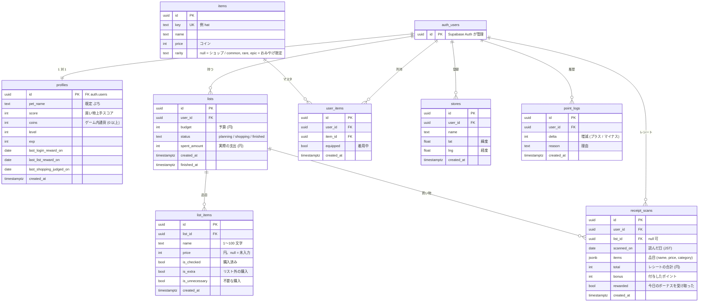

# データベース (Supabase / Postgres)

DB の正は `supabase/migrations/*.sql` です。このページは、そこから読み取った内容をまとめたものです。
(古い図として [../db/schema.html](../db/schema.html) もあります。食い違ったら migration が正です。)

## ER 図 (テーブルと関係)



図の `auth_users` は、Supabase Auth が持つ `auth.users` テーブルです (Mermaid では `.` が使えないため `_` にしています)。

## テーブルの説明

| テーブル | 説明 |
|---|---|
| `profiles` | ユーザー 1 人に 1 行。ペット名、スコア、コイン、レベル、経験値と、日ごとの報酬を渡した日付。新規登録すると、トリガー `on_auth_user_created` が自動で作る |
| `lists` | 買い物リスト。状態は `planning` (作成中) → `shopping` (買い物中) → `finished` (完了)。完了していないリストは 1 人 1 つまで (一意インデックス) |
| `list_items` | リストの品目。金額は買ったときに入れる (`null` = 未入力)。リスト外の購入 (`is_extra`) と不要な購入 (`is_unnecessary`) の印を持つ |
| `items` | 着せ替えアイテムのマスタ (全員共通)。初期データは `hat` (ぼうし 30)、`ribbon` (リボン 40)、`crown` (おうかん 200)、`glasses` (めがね 60)。`rarity` が入っているものは、おみやげ (予算内クリアのドロップ) 限定で買えない: `straw` `beanie` (common)、`chef` (rare)、`wizard` (epic) |
| `user_items` | 誰がどのアイテムを持っているか、着ているか。同じアイテムは 1 人 1 つまで |
| `stores` | よく行くスーパー (名前と緯度経度)。現在地は保存しない |
| `point_logs` | ポイントの増減の履歴 (理由つき) |
| `receipt_scans` | レシートの AI 判定 (REQ-012) の回数と読み取り結果。1 回読むごとに 1 行。画像は保存しない。1 日の回数制限は `(user_id, scanned_on)` の件数、ボーナスの 1 日 1 回は部分一意インデックス (`rewarded` の行は 1 日 1 つ) で守る |

## RLS の考え方 (誰が何を読める・書けるか)

**RLS** (Row Level Security) は「行ごとに、誰が読み書きできるか」を DB 側で決める仕組みです。
すべてのテーブルで RLS を有効にしています。さらに、ログインした人 (`authenticated`) に許す操作と列を、`grant` で最小限にしています。

- **自分の行だけ**: どのテーブルも、読めるのは自分の行だけです (`user_id = auth.uid()`)。`list_items` は、親の `lists` が自分のものかで判断します。
- **`items` (マスタ)**: ログインした人なら誰でも読めます。書けません。
- **ブラウザから直接書けるもの** (自分の行のみ):
  - `profiles.pet_name` の変更
  - `lists` の作成 (`user_id`, `budget`)、`budget` の変更、削除
  - `list_items` の作成・削除と、`name` `price` `is_checked` `is_extra` `is_unnecessary` の変更
  - `user_items.equipped` の変更
  - `stores` の作成・変更・削除
- **API (secret キー) だけが書けるもの**: コイン、スコア、レベル、経験値、報酬の日付、リストの状態 (`status`) と支出 (`spent_amount`)、アイテムの購入 (`user_items` の追加)、`point_logs` の追加。
- **`receipt_scans`**: ブラウザからは読めません・書けません (policy と `grant` なし)。API だけが使います。
- **完了したリストの品目**: ブラウザから変えられるのは `price` と `is_unnecessary` だけです (トリガー `list_items_guard_finished` が他の列の変更を拒否します)。
- **ログインしていない人 (`anon`)**: どのテーブルにも権限がありません。

secret キー (service_role) は RLS を通らずに全部を操作できます。そのため、**secret キーは backend の中だけで使います。**

> 現在の frontend は、リストや品目も API 経由で読み書きしています。上の「ブラウザから直接書けるもの」は、DB が許している範囲です。

### DB の関数 (rpc)

supabase-js にはトランザクション (複数の更新をまとめて 1 回で行う仕組み) がないため、まとめて行いたい更新は Postgres の関数にしています。どれも API (service_role) だけが呼べます。

| 関数 | 内容 |
|---|---|
| `buy_item(p_user_id, p_item_key)` | コインを減らし、`user_items` に行を足す。コイン不足・所持済み・存在しないアイテムはエラー |
| `grant_drop(p_user_id, p_item_key, p_coins)` | おみやげを付与する。帽子を `user_items` に足せたら `'item'`。`p_item_key` が `null` か所持済みなら、`coins` を `p_coins` だけ増やして (`score` は変えない) `point_logs` に「おみやげ」を残し、`'coins'` を返す |
| `reserve_receipt_scan(p_user_id, p_list_id, p_today, p_limit)` | 今日のレシートの読み取りが `p_limit` 回未満なら `receipt_scans` に 1 行足して id を返す。上限なら `null`。`profiles` の行をロックするので、同時に呼ばれても上限を超えない |
| `add_points(p_user_id, p_delta, p_reason)` | `coins` と `score` を増減し (コインは 0 未満にしない)、`point_logs` に 1 行足す |

## マイグレーションの追加方法

**マイグレーション** は「DB の変更を SQL ファイルとして順番に残したもの」です。すでにあるファイルは書き換えず、新しいファイルを足します。

1. 新しいファイルを作る。

   ```bash
   supabase migration new <変更の名前>   # 例: add_item_slot
   ```

   `supabase/migrations/<日時>_<変更の名前>.sql` ができます。既存のファイル名も `20261117000000_buy_item.sql` のような形です。

2. SQL を書く。新しいテーブルを足すときは、既存のファイルと同じく次をそろえます。
   - `alter table ... enable row level security;`
   - `revoke all on ... from anon, authenticated;` のあと、必要な操作と列だけ `grant`
   - 自分の行だけを許す `create policy` (`(select auth.uid())` の形で書く)

3. ローカルの DB に反映する。

   ```bash
   supabase db reset   # ローカルの DB を作り直し、migrations をすべて流し直す (ローカルのデータは消えます)
   ```

4. backend の `repository.ts` と `infra/supabase.ts`・`infra/memory.ts`、このページの ER 図を更新する。

着せ替えアイテムを足すときは、新しい migration で `insert into public.items (key, name, price) values (...)` を書き、`frontend/app/features/pet/accessories.tsx` に同じ `key` の絵を足します。
